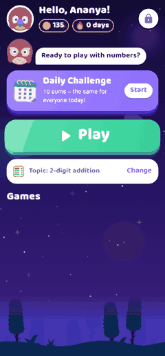

# Ganita Aata (ಗಣಿತ ಆಟ)

A maths practice game for children of Classes 1–8 in Karnataka, built with
Flutter. Short 2–3 minute rounds make children fast, accurate and confident in
addition, subtraction, tables, division, squares, cubes, fractions and
percentages. The app adapts to each child and keeps a progress report for
parents.

- **12 languages**: Kannada (default), English, Hindi, Marathi, Tamil, Telugu,
  Malayalam, Bengali, Gujarati, Punjabi, Odia and Urdu (right-to-left),
  chosen on first launch and switchable in Settings.
- **Fully offline**: no internet permission, no ads, no login, no analytics.
- **Child-safe**: only the child's first name and class are stored, and only
  on the phone. Settings, Progress and reset are behind a parent PIN.
- Package name: `com.ganitaaata.app`. Portrait only.

 

## Features

| | |
|---|---|
| **Profiles** | Several children per phone, each with name, class (1–8) and avatar; switch by tapping the avatar on Home. |
| **Home** | Greeting, Daily Challenge card, streak, coins, Play button, game cards, Shop and Badges. |
| **Level map** | A winding path of 5 levels; locked levels show a lock. Tap a level → topic → game. |
| **Balloon Pop** | 4 answer balloons float up; tap the right one (pop + sound). A wrong tap gives a gentle shake and shows the right balloon. 2-minute round. |
| **Race Car** | Each right answer moves your car; the computer's car runs at a steady speed set by the level (130–170 s to finish). |
| **Treasure Hunt** | 5 right answers in a row open a chest (+5 coins). 2½-minute round. |
| **Tables Master** | Pick a table 2–20. *Learn* reads each line aloud in the chosen language; *Quiz* asks the table in random order. |
| **Speed Challenge** | 60 seconds with a big number pad; shows score and personal best (per topic). |
| **Daily Challenge** | The same 10 sums for the whole day (seeded by date and the child's level). Finishing it extends the streak. |
| **Result** | Score, 1–3 stars, correct / to-practise counts, coins, the sums to practise with their answers, Play again / Home. |
| **Shop** | Spend coins on avatars, car colours and balloon themes. |
| **Badges** | Table *N* Master, 7-day streak, 30-day streak, 100 sums in a day, Speed Star (20+ in 60 s), with a pop-up when earned. |
| **Progress** (parent) | Total sums, accuracy, facts mastered, accuracy per topic, average-seconds-per-sum chart (fl_chart), weak facts, days-practised calendar. |
| **Settings** (parent) | Language, sound, daily reminder and time, change PIN, reset progress, remove a child, about/licences. |
| **Reminder** | "Time for today's Ganita Aata challenge!" every day at the parent's chosen time in Asia/Kolkata; survives restarts. |

Messages are always encouraging ("Try again, you can do it!"); mistakes are
shown in soft orange, never red.

## Content levels

| Level | Classes | Topics (unlock order) |
|---|---|---|
| 1 | 1–2 | numbers up to 100 · single-digit addition · single-digit subtraction |
| 2 | 3 | 2-digit addition · 2-digit subtraction · tables 2–5 |
| 3 | 4 | tables 6–10 · 3-digit addition · 3-digit subtraction · simple division |
| 4 | 5 | tables 11–20 · 2-digit × 1-digit · division with remainder |
| 5 | 6–8 | mixed operations · squares 1–30 · cubes 1–15 · percentages · simple fractions |

A new child starts with every topic of the levels below their class and the
first topic of their own level.

## How it works

- **Sum generator** (`lib/engine/sum_generator.dart`) makes every question on
  the fly; there is no question bank. Answers are never negative, division is
  exact except in "division with remainder", and multiple-choice options are 3
  close, believable wrong answers (±1, ±10, neighbouring table values, (n±1)²…),
  all different from each other and from the right answer.
- **Adaptive engine** (`lib/engine/adaptive_engine.dart`) records every answer
  (fact, topic, right/wrong, time, date). Each fact (e.g. `7 × 8`) has a
  mastery state: **mastered after 3 correct answers in a row, each within
  5 seconds**; a wrong answer removes mastery. Questions are chosen by weighted
  random — weak facts more often, unseen facts normally, mastered facts rarely
  (revision). When accuracy on a topic is **above 85% over its last 30
  answers**, the next topic unlocks.
- **Rewards** (`lib/engine/rewards.dart`): 1 star ≥ 50%, 2 stars ≥ 75%,
  3 stars ≥ 90%; 1 coin per right answer + 10 for 3 stars (+5 per treasure
  chest, +5 for winning a race).

## Project layout

```
lib/
  main.dart              app start-up, providers, localisation
  models/                Question, Profile, stats, game results
  data/                  curriculum (levels/topics), shop catalogue, Hive storage
  engine/                sum generator, adaptive engine, rewards/streak rules
  games/                 the six game modes + launcher
  screens/               splash, language, profile, home, level map, result,
                         shop, badges, PIN, progress, settings
  widgets/               theme, answer grid, number pad, game shell, …
  services/              AppState (Provider), audio (just_audio), notifications
  l10n/                  app_en.arb, app_kn.arb (+ generated Dart)
assets/
  audio/                 placeholder voice clips and sound effects
  fonts/                 Baloo Tamma 2 + Noto Sans Kannada (SIL OFL)
  images/                flat 2D vector illustrations (SVG, Fluent Emoji, MIT)
test/                    unit and widget tests
tool/                    gen_audio.py, gen_icon.py
```

State management is `provider` (`AppState` is a `ChangeNotifier`); storage is
Hive (`hive_ce`) with JSON values, all on the device.

## Build

Requires Flutter 3.47.9 (stable; CI is pinned to it), Dart 3.13+, JDK 17 and the Android SDK.

```sh
cd ganita_aata
flutter pub get
flutter analyze
flutter test                      # generator, engine, rewards, notifications, widgets, layouts
flutter build apk --release       # build/app/outputs/flutter-apk/app-release.apk
```

The release build uses `android/key.properties` (`storeFile`,
`storePassword`, `keyAlias`, `keyPassword`) when present; otherwise it is
signed with the debug key so the APK still installs. For the Play Store,
create an upload key and that file (do not commit it), then build an app
bundle with `flutter build appbundle --release`.

CI (`.github/workflows/ganita-aata.yml`) runs analyze and tests, builds the
release APK, checks the build log for warnings, verifies the package name and
that the APK has **no INTERNET permission**, and uploads the APK as an
artifact.

## Replacing audio files

Everything in `assets/audio/` is a **placeholder**: voice clips were
synthesised with espeak-ng (understandable but robotic) and sound effects are
simple tones. Replace any file with a real recording **of the same name**;
no code changes are needed.

| Path | Content |
|---|---|
| `assets/audio/kn/n_<0–100>.ogg` | the number spoken in Kannada |
| `assets/audio/en/n_<0–100>.ogg` | the number spoken in English |
| `assets/audio/kn/tables/t<a>_<b>.ogg` | one table line in Kannada, e.g. `t7_8.ogg` = "ಏಳು ಎಂಟ್ಲ ಐವತ್ತಾರು" (a = 2–20, b = 1–10) |
| `assets/audio/en/tables/t<a>_<b>.ogg` | the same in English: "seven times eight is fifty-six" |
| `assets/audio/sfx/correct.ogg` | right answer |
| `assets/audio/sfx/wrong.ogg` | gentle "not quite" sound (keep it soft) |
| `assets/audio/sfx/pop.ogg` | balloon pop |
| `assets/audio/sfx/coin.ogg` | coins earned / item bought |
| `assets/audio/sfx/badge.ogg` | badge earned |
| `assets/audio/sfx/chest.ogg` | treasure chest opens |
| `assets/audio/sfx/tap.ogg` | spare UI tap sound |

Tips:

- Keep the `.ogg` extension (Opus or Vorbis inside both work). MP3 also
  plays, but then change the extension in `lib/services/audio_service.dart`.
- Mono, 16–24 kHz, 16–32 kbps keeps the APK small; trim silence at both ends.
- Table lines are played one after another in Learn mode, so keep each under
  about 3 seconds.
- After a wrong answer the right answer is spoken (number clips, answers up
  to 100); in the Tables quiz the whole table line is read instead.
- To regenerate the placeholders (needs `espeak-ng` with the `kn` voice,
  `ffmpeg` with libopus and `numpy`): `python3 tool/gen_audio.py`.

## Adding a new topic

1. **Curriculum** – add a `Topic(id: 'myTopic', level: N)` to the right level
   in `lib/data/curriculum.dart`. Its position in the list is its unlock
   order (the topic before it unlocks it).
2. **Generator** – add a `case 'myTopic':` to `SumGenerator.generate` in
   `lib/engine/sum_generator.dart` that returns
   `Question.fromParts('myTopic', Op.xxx, a, b, c)`. Use an existing `Op` if
   one fits; for a new kind of sum, add it to `Op` in
   `lib/models/question.dart` and give it an answer in `Question.fromParts`,
   an `expression`, distractors in `SumGenerator.wrongOptions` and, if it is a
   sentence, a localised form in `questionText` (`lib/widgets/l10n_ext.dart`).
   If the topic has a small fixed set of facts (≤ a few hundred), also list
   them in `SumGenerator.allFacts` so the adaptive engine can weight each one.
3. **Strings** – add `"topic_myTopic"` to **both** `lib/l10n/app_en.arb` and
   `lib/l10n/app_kn.arb`, and map it in `topicName` in
   `lib/widgets/l10n_ext.dart`. Run `flutter gen-l10n` (or any build).
4. **Tests** – `test/sum_generator_test.dart` loops over every topic, so the
   new one is checked automatically for negative answers, exact division and
   unique options. Run `flutter test`.

## Localisation

All visible text lives in `lib/l10n/app_<code>.arb` – `kn` (default), `en`,
`hi`, `mr`, `ta`, `te`, `ml`, `bn`, `gu`, `pa`, `or`, `ur` – generated into
`lib/l10n/app_localizations*.dart`. Praise and encouragement messages are
`|`-separated lists in `praise` and `encourage`. The language list (native
names) is `lib/data/languages.dart`.

- **Translations other than Kannada and English were machine-written and need
  review by native speakers** before release; keep placeholders such as
  `{n}` and `{name}` unchanged.
- **Fonts**: each script has a matching rounded Baloo font for titles and
  numbers (Baloo 2 family, subset per script); body text uses the phone's
  own Noto fonts for scripts other than Kannada.
- **Urdu** is laid out right to left; sums, answers, number pads and the PIN
  pad always stay left to right (`mathDirection()` in `l10n_ext.dart`).
- **Audio**: every language has spoken numbers 0–100 and table lines in
  `assets/audio/<code>/` (placeholders from `tool/gen_audio.py <code>`).
- **Adding a language**: add `app_<code>.arb`, a row in `languages.dart`, a
  `TABLE_LINE` entry in `tool/gen_audio.py` (then run it), the asset folders
  in `pubspec.yaml`, a Baloo font for a new script, and
  `android/app/src/main/res/values-<code>/strings.xml` for the launcher name.

## Look and feel

- **Theme – "night-sky adventure"** (`lib/widgets/app_theme.dart`): a deep
  indigo-to-violet sky with stars and soft glowing planets behind every
  child screen, white text on the sky, white cards with a glowing rim for
  sums, **gold** for the main action, and one two-tone gradient per game /
  answer button (sunset, ocean, mint, mango, grape, berry). Stick to
  `AppColors` – no new colours. Landscapes appear as a violet night
  tree-line along the bottom. Parent screens (Progress, Settings, PIN) use
  a calm light theme (`buildParentTheme()`).

- **Game art** (`assets/game/*.png`, Kenney, CC0 public domain): 30 round
  animal avatars, landscape scenes (grass, forest, autumn, castles, desert),
  clouds, trees, houses, castle, medals and race cars/track props.
  `GameImage('name')` shows one; `GameBackground(scene: Scene.grass)` draws a
  landscape under the sky.
- **Motion** (`lib/widgets/motion.dart`): soft zoom-and-fade screen
  transitions, twinkling stars, sums and answer buttons that pop in one by
  one, an owl that hops for right answers and tilts "hmm" for wrong ones,
  scores and coins that count up, a gold time bar in timed games, a light
  sweep across gold buttons, confetti behind new badges, haptic taps, plus bobbing owl mascot and avatar,
  drifting clouds, pulsing Play button, wiggling game icons, bouncing card
  entrances, a hopping "you are here" avatar on the level map, coins and
  star bursts on right answers, and a flame combo counter for answers in a
  row. Looping motion stops when the phone's "remove animations" setting is
  on (`motionEnabled` switches it off in tests).
- **Music** (`assets/audio/music/`): two original loops composed by
  `tool/gen_music.py` – `menu.ogg` (calm) on menus and `game.ogg` (bouncy)
  during games – with a separate Music switch in Settings. Music pauses when
  the app goes to the background. Success sounds (`correct`, `coin`, `chest`,
  `badge`, `win`) are Kenney Music Jingles (CC0). Replace any file with one of
  the same name to change it.


- **Fonts** (`assets/fonts`, SIL Open Font License): Baloo Tamma 2, a rounded,
  playful face covering Kannada and Latin, for titles, buttons and numbers;
  Noto Sans Kannada for body text.
- **Illustrations** (`assets/images/*.svg`): flat 2D vectors from Microsoft's
  Fluent Emoji ("Flat" style, MIT licence, see `LICENSE-fluentui-emoji.txt`),
  drawn with `flutter_svg` so they stay sharp on every screen and add only
  about 200 KB. Avatars are `av_<name>.svg`; to change any picture, replace the
  SVG with one of the same name. `AppImage('name')` shows one.
- **Widgets** (`lib/widgets/common.dart`): `ChunkyButton` (3D game button
  that sinks when pressed), `BigCard`, `Panel`, `GameBackground`,
  `MascotBubble` (the owl), plus `confetti.dart` and `badge_icon.dart`.

## Notifications

`lib/services/notification_service.dart` schedules one notification that
repeats daily at the chosen wall-clock time in **Asia/Kolkata**
(`timezone` package, `matchDateTimeComponents: time`). The plugin's boot
receiver in `AndroidManifest.xml` restores it after a restart or app update,
and the app re-schedules it on every launch. Exact alarms are used where
Android allows them without a special permission (Android 11 and older);
on Android 12+ an inexact alarm is used, which Android may delay by a few
minutes to save battery. Android 13+ asks the parent for notification
permission when the reminder is turned on.

## Privacy and Play Families policy

- No ads, no third-party SDKs that collect data, no external links in child
  screens (the only link-like item is the licences page in parent Settings).
- No `INTERNET` permission in the release build (CI checks this).
- Stored on device only: child's first name, class, avatar, scores, coins,
  badges and answer history (capped at 5,000 answers per child), the parent
  PIN as a salted SHA-256 hash, and settings. Backups are disabled
  (`android:allowBackup="false"`).
- Removing a child or resetting progress deletes their data; clearing the
  app's storage deletes everything (including a forgotten PIN).
