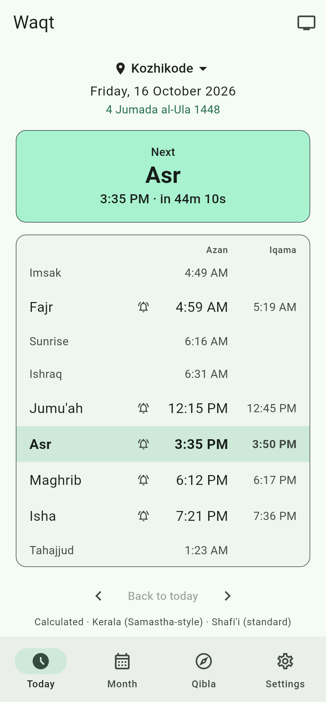
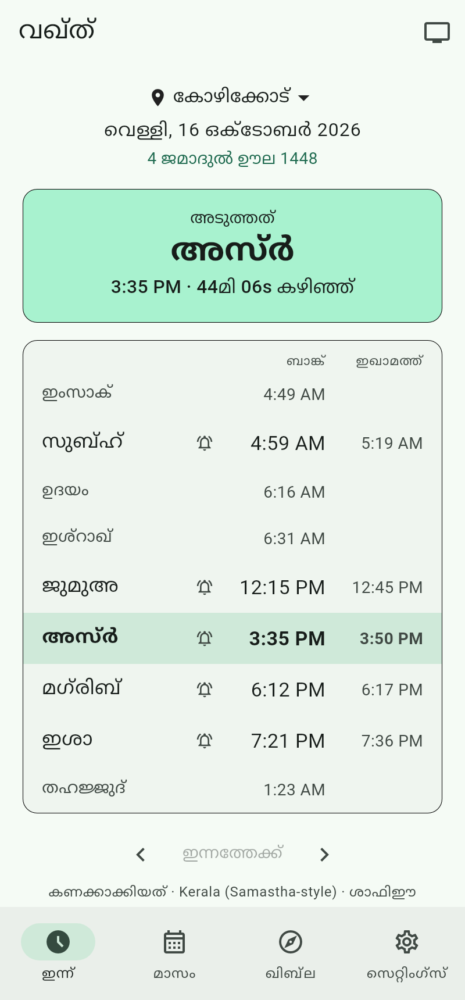
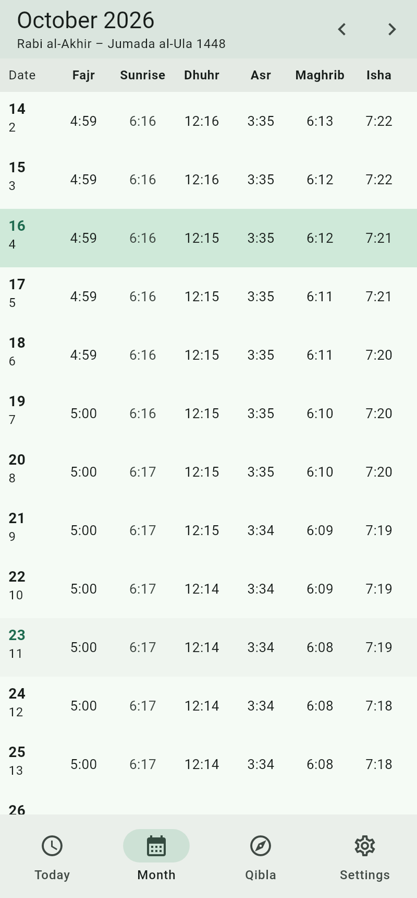
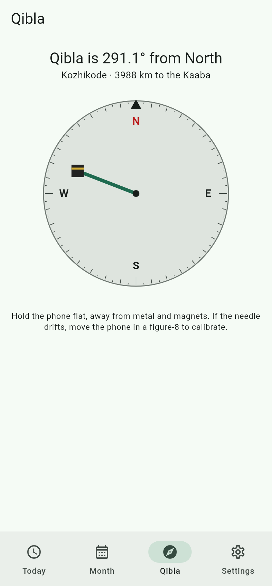
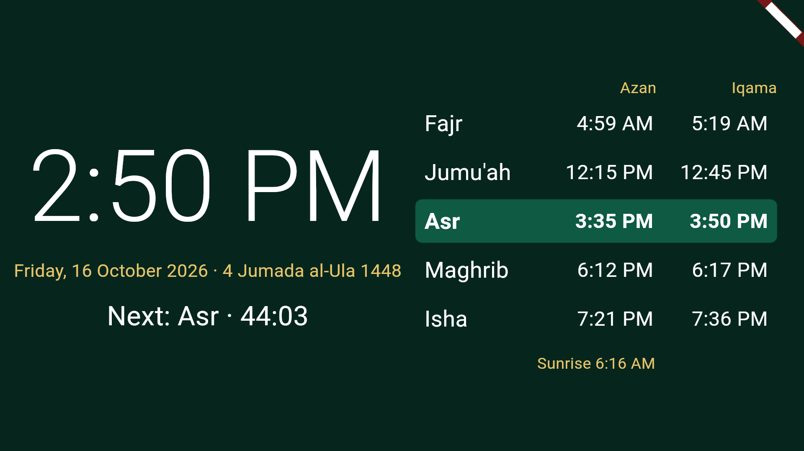

# Waqt (വഖ്ത്) – Salah times, Azan & Iqama alerts

<p>




</p>
<p></p>

An offline prayer-time app for Android, built with Flutter, made first for
Kerala and working anywhere. No ads, no tracking and no internet permission.

## Features

- **Today**: the five prayers plus Sunrise, with Iqama times, a live
  countdown to the next prayer, and an Iqama countdown between Azan and
  Iqama. On Fridays Dhuhr shows as Jumu'ah, with its own Iqama delay.
  Optional extra times: Imsak (end of Suhoor), Ishraq and Tahajjud (the last
  third of the night). Swipe through days with the arrows.
- **Month**: a full month's timetable with Hijri dates; Fridays and today
  are highlighted.
- **Qibla**: the bearing and distance to the Kaaba, and a tilt-compensated
  compass. It reads the sensors only while the tab is open.
- **Alerts**: for each prayer, Azan and Iqama notifications on or off, the
  Iqama delay, and a reminder before Azan. Also Imsak and Tahajjud alerts.
- **Fixed Iqama times**: optionally a fixed clock time per prayer and for
  Jumu'ah, as mosques announce it (for example Dhuhr Iqama at 1:00 PM). It
  is used whenever it falls after Azan, within 3 hours. When the seasons
  move Azan past it, the app falls back to the minutes-after-Azan delay.
- **Home-screen widget**: the next prayer with a live countdown and the
  day's five times, with the next one highlighted. The app hands it 20 days
  of times, and the widget redraws itself when each prayer passes, so it
  stays right without the app running.
  - Alerts are scheduled as exact alarms (`alarmClock` mode), so they still
    fire when the phone is in Doze.
  - The Azan uses the alarm audio stream and repeats until dismissed, for at
    most 3 minutes.
- **Auto silent**: switches the phone to vibrate, or to silent through Do
  Not Disturb, from Azan until N minutes after Iqama (a longer window for
  Jumu'ah), then restores the ringer. If you changed the ringer yourself
  during the prayer, it is left alone.
- **Timetables**: import a mosque's or Samastha's yearly chart as CSV (or
  paste it). Days the chart covers use it exactly; other days are
  calculated. You can also copy the calculated year as CSV, as a starting
  point.
- **Mosque display mode**: a full-screen clock for a prayer-room TV or
  tablet. It shows the date, Hijri date, the next prayer or Iqama countdown,
  and the Azan/Iqama table, keeps the screen on, and adapts to portrait or
  landscape.
- **Places**: 45 presets. All 14 Kerala districts and major towns come
  first; Lakshadweep, Karnataka, Tamil Nadu, other Indian cities, the
  Maldives and the Gulf follow. You can also use GPS (Android's own
  `LocationManager`, no Google Play services) or enter coordinates by hand.
  Picking a place applies its usual method and Asr school.
- **Languages**: English and Malayalam.
- **Health check**: warns when notifications, exact alarms or battery
  optimisation would make alerts late, and links to the setting that fixes
  it.

## Calculation

`lib/core/prayer_calc.dart` computes the sun's position for each event
(iterated three times) and returns UTC instants. Methods:

| Method | Fajr | Isha | Built-in margins |
|---|---|---|---|
| **Kerala (Samastha-style)** (default) | 19.5° | 18.5° | Dhuhr +3, Asr +2, Maghrib +3 min |
| Karachi | 18° | 18° | – |
| Muslim World League | 18° | 17° | – |
| Umm al-Qura | 18.5° | 90 min after Maghrib (120 in Ramadan) | – |
| Dubai | 18.2° | 18.2° | Dhuhr/Asr/Maghrib +3 min |
| Qatar | 18° | 90 min after Maghrib | – |
| Kuwait | 18° | 17.5° | – |
| Egypt | 19.5° | 17.5° | – |
| ISNA | 15° | 15° | – |

- **Asr**: Shafi'i (shadow factor 1) or Hanafi (2).
- **High latitudes**: angle-based (the default), middle of the night, or one
  seventh of the night.
- **Your own adjustments**: you can add ± minutes to any time.

**How the Kerala preset was derived**: an astronomical model was fitted to
published Kerala yearly charts. It reproduces them to about ±1 minute over
the year at the chart's own location. For exact agreement with a particular
mosque, import its chart (see **Timetable CSV format** below).

**Accuracy**: `test/core/prayer_calc_test.dart` checks the engine against
values from the independent [`astral`](https://github.com/sffjunkie/astral)
library (NOAA algorithm). The cases are Kozhikode (January and June), Makkah
and London, and every time agrees within one minute.

`dart run tool/print_times.dart <lat> <lng> <utcOffsetMinutes> [year] [method] [asr]`
prints a whole year as CSV, for comparing against a printed chart.

## Timetable CSV format

```
# name: My Mosque, Kozhikode
# utc_offset: +05:30
# source: Printed yearly chart
date,fajr,sunrise,dhuhr,asr,maghrib,isha
01-01,05:28,06:51,12:36,15:51,18:17,19:32
2027-01-01,05:29,06:52,12:37,15:52,18:18,19:33
```

- **Dates**: `MM-DD` rows repeat every year. `YYYY-MM-DD` rows apply to that
  year only and take priority. A missing 29 February uses 28 February.
- **Times**: `HH:mm` (24-hour) or `h:mm AM/PM`.
- **Separators**: `,`, `;` or tab.
- **Columns**: they can be in any order, after `date`.
- **Checks**: each row must be in day order, so a 12-hour chart without
  AM/PM is caught.

Only import charts you are allowed to use, such as your mosque's own
timetable or a published calendar whose publisher permits it.

## Build

```sh
cd waqt
flutter pub get
flutter test                 # unit + widget tests
flutter test tool/screenshots/screenshot_test.dart  # docs/screenshots/*.png
flutter build apk --release  # or: flutter build appbundle
```

- **Requirements**: Flutter 3.47+ (Dart 3.13), the Android SDK and JDK 17.
- **Release signing**: put `storeFile`, `storePassword`, `keyAlias` and
  `keyPassword` in `android/key.properties` (gitignored). Without it, the
  release build is signed with the debug key.

## Android permissions

| Permission | Why |
|---|---|
| `POST_NOTIFICATIONS` | Azan / Iqama notifications |
| `SCHEDULE_EXACT_ALARM` | Alerts and auto-silent on the minute (the user grants it; the app checks for it and links to the setting) |
| `RECEIVE_BOOT_COMPLETED` | Re-arm alarms after a restart |
| `ACCESS_COARSE/FINE_LOCATION` | "Use my location", only when tapped |
| `ACCESS_NOTIFICATION_POLICY` | Auto-silent in Do Not Disturb mode (optional) |
| `VIBRATE` | Vibrate mode and alerts |

There is no `INTERNET` permission in release builds.

## Layout

```
lib/core/      pure Dart, unit tested: astronomy, methods, timetables,
               Hijri, Qibla, places, alert/silent planning
lib/app/       settings, strings (en/ml), notifications, native bridge
lib/screens/   Today, Month, Qibla, Settings, Place, Alerts, Timetable,
               mosque display
android/.../MainActivity.kt    GPS, DND/battery settings, method channel
android/.../SilentScheduler.kt auto-silent alarms + boot/time receiver
android/.../WaqtWidgetProvider.kt home-screen widget
```

## Not done yet (ideas)

- Azan audio tracks: needs recordings that are licensed for use, added under
  `android/app/src/main/res/raw/` and offered as notification channel
  sounds
- Wear OS
